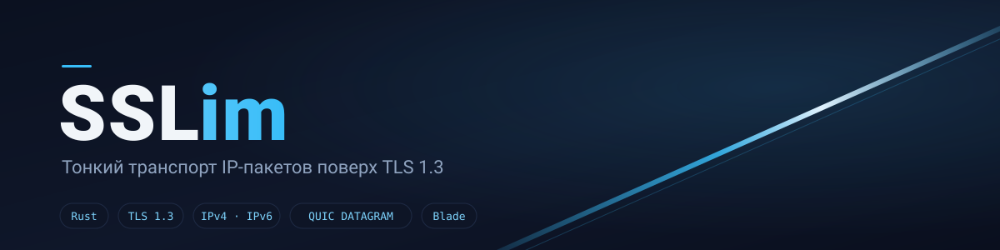

<div align="center">



[Скачать](https://github.com/doctorBax/sslim/releases/latest) · [Запуск](#запуск) · [Blade](#blade--клиент-для-windows) · [Замеры](#замеры) · [История версий](CHANGELOG.md)

</div>

---

SSLim передаёт IP-пакеты между двумя узлами. Клиент проверяет сертификат сервера через TLS 1.3 и аутентифицируется общим секретом. Без валидной аутентификации сервер отвечает заглушкой или 404, как обычный веб-сайт. Версия на Rust совместима с Python-клиентом и сервером из v0.1.0.

Windows-клиент называется **Blade** и запускается подкомандой `sslim blade`.

```text
Linux TUN  ←→  Клиент  ═══════ TLS 1.3 ═══════  Сервер  ←→  Linux TUN
```

## Запуск

На чистом Ubuntu VPS (x86_64) укажите публичный IPv4 или DNS-имя вместо `vpn.example.com`:

```bash
curl -fsSLO https://raw.githubusercontent.com/doctorBax/SSLim/main/scripts/install-server.sh
sudo bash install-server.sh vpn.example.com
```

Разрешите входящий TCP-порт 9443 в панели VPS и в локальном файрволе, если он включён. Установщик запускает системную службу и печатает первую ссылку `sslim://`. Храните её как пароль. Сертификат действует год, поэтому перед истечением срока потребуется обновить сертификат и профили.

- `sudo sslim-client add laptop` выдаёт отдельную ссылку для устройства.
- `sudo sslim-client list` показывает список ключей.
- `sudo sslim-client remove laptop` отзывает ключ для новых подключений.
- Windows: распакуйте ZIP из релиза и запустите `install.ps1` либо используйте команду ниже. Вставьте ссылку в Blade, чтобы подключиться. В следующий раз введите `connect`.
- Android: скачайте `Blade.apk` из того же релиза, импортируйте ссылку и нажмите стрелку. При первом запуске Android запросит разрешение VPN.

Служба поддерживает один активный TUN-сеанс. Чтобы переключиться на другое устройство, сначала отключите текущее.

### Ручная настройка Linux

Скачайте и распакуйте архив [последнего релиза](https://github.com/doctorBax/sslim/releases/latest) для Linux x86_64 с glibc 2.34 или новее. Для сборки из исходников выполните `cargo build --release --locked`. При локальной сборке исполняемый файл появится в `target/release/sslim`.

На сервере:

```bash
./sslim server --host 0.0.0.0 --port 9443 --device tun \
  --cert /path/to/fullchain.pem --key /path/to/privkey.pem \
  --secret-file /path/to/session.bin --tun-name labtun0
```

Для отдельных ключей добавляйте клиентов командами `sslim clients add`, `list` и `remove`. Ссылка содержит ключ конкретного клиента. Если сервер использует свой центр сертификации, передайте его сертификат через `--ca-file`.

```bash
./sslim clients add --label alice --host vpn.example.com \
  --secrets-file /etc/sslim/clients.txt --ca-file /etc/sslim/server.crt
./sslim server --host 0.0.0.0 --port 9443 --device tun \
  --cert /etc/sslim/server.crt --key /etc/sslim/server.key \
  --secrets-file /etc/sslim/clients.txt --tun-name labtun0
./sslim clients list --secrets-file /etc/sslim/clients.txt
./sslim clients remove alice --secrets-file /etc/sslim/clients.txt
```

Сервер перечитывает список ключей при каждом новом подключении. Добавление и отзыв ключа не перезапускают службу. Уже открытые сеансы завершаются при отключении клиента.

На клиенте:

```bash
./sslim client --host vpn.example.com --port 9443 \
  --server-name vpn.example.com --secret-file /path/to/session.bin \
  --tun-name labtun0
```

Оба узла используют один файл с общим секретом длиной не менее 32 случайных байт. Если сертификат подписан вашим центром сертификации, передайте клиенту его сертификат через `--ca`. Режим TUN требует `/dev/net/tun` и прав на создание интерфейса. Адреса интерфейсов, маршруты и NAT настраиваются средствами Linux.

Для проверки без маршрутов используйте сервер в режиме `--device echo` и команду `sslim probe` с теми же параметрами TLS и секрета. По умолчанию сервер слушает loopback в echo-режиме.

## Blade — клиент для Windows

`sslim blade` подключается по профилю из `%APPDATA%\sslim\profiles`, поднимает Wintun-адаптер, направляет весь IPv4-трафик в туннель через 32 маршрута /1–/32 (адрес сервера остаётся на основном шлюзе) и блокирует исходящий IPv6 firewall-правилом, пока туннель активен. Выходной IP проверяется запросом к `https://1.1.1.1/cdn-cgi/trace` с отключёнными прокси. Соединение поддерживается ping-фреймами и переподключается автоматически с задержкой 1–30 с. Требуются права администратора и `wintun.dll` (ищется рядом с `sslim.exe`, либо `--wintun-dll`).

После публикации Windows-пакета установите Blade одной командой в PowerShell:

```powershell
irm https://raw.githubusercontent.com/doctorBax/sslim/main/scripts/install.ps1 | iex
```

Установщик скачает архив из последнего релиза, установит его в `%LOCALAPPDATA%\sslim`, добавит команду `sslim` в пользовательский `PATH` и откроет консоль Blade. При первом запуске вставьте `sslim://` ссылку или выполните `connect`, затем подтвердите системный запрос Wintun.

В консоли работают `/help`, `!help`, `list`, `add <ссылка>`, `connect [имя]` и `exit`. Вставка ссылки напрямую сохраняет профиль и сразу начинает подключение.

```bash
sslim blade import "sslim://vpn.example.com:9443?sni=vpn.example.com&k=BASE64&n=home"
sslim blade list
sslim blade --stats        # подключиться активным профилем
sslim blade show home --qr # напечатать профиль QR-кодом
sslim blade remove home
```

Параметры активного профиля перекрываются флагами: `--host`, `--port`, `--server-name`, `--secret-file`, `--ca`, `--wintun-dll`, `--route-script`, `--stats`. Маршруты настраивает `blade-routes.ps1` — при установке он лежит рядом с `sslim.exe`.

## Профили и раздача

Каждому клиенту выдаётся собственный секрет — утёкший отзывается удалением строки, остальные клиенты продолжают работать.

На сервере:

```bash
sslim keygen --output alice.bin              # секрет клиента
sslim server --secrets-file secrets.txt ...  # строки label:base64, по одной на клиента
sslim profile --host vpn.example.com --secret-file alice.bin --label alice
```

`sslim profile` печатает `sslim://`-ссылку и QR-код — передайте её клиенту любым способом. Ссылка содержит только данные этого клиента.

## Blade для Android

Приложение в каталоге `android/` — то же транспортное ядро, профили хранятся в приложении, ничего не зашито в сборку. Профили импортируются кликом по `sslim://`-ссылке, из буфера или заполняются вручную; всё редактируемо. Сборка:

```powershell
powershell -NoProfile -ExecutionPolicy Bypass -File android\build.ps1 `
  -Sdk C:\path\to\android-sdk `
  -Jdk C:\path\to\jdk-17
```

Подписанный APK появится в `android\build\Blade.apk`. Требуется Android 10+.

## Замеры

В лабораторном тесте на Debian 12 один и тот же Python-клиент отправлял по 131 072 пакета через TLS на loopback. CPU измерялся у процесса сервера. В режиме echo сервер возвращает каждый пакет, а клиент проверяет его содержимое и порядок.

| Размер пакета | v0.1.0 · Python | v0.2.0 · Rust | CPU Python → Rust |
| --- | ---: | ---: | ---: |
| 64 Б | 31 424 пак./с | 116 798 пак./с | 4,09 → 0,31 с |
| 1280 Б | 25 174 пак./с | 67 821 пак./с | 5,16 → 0,88 с |

Скорость на внешнем маршруте и LTE в этом замере не измерялась. В режиме TUN Rust переиспользует буферы и отправляет пачкой уже доступные пакеты. Формат кадров остался прежним.

## Проверка

```bash
cargo test --locked
python3 -m pip install -r requirements-dev.txt
python3 -m scripts.verify target/release/sslim --bench
sudo bash scripts/tun-check.sh target/release/sslim
```

У скрипта проверки TUN есть зависимости от Python 3, `ip`, `ping`, `unshare` и `nsenter`. Он создаёт два временных сетевых пространства имён и проверяет обмен IPv4 и IPv6 между ними.

## Экспериментальный QUIC на Linux

`sslim quic server` и `sslim quic client` используют UDP и QUIC DATAGRAM. Сервер и клиент принимают имя TUN через `--tun-name`. Настройте оба интерфейса на MTU 1280. Выделите отдельный UDP-порт и отдельную пару TUN для проверки рядом с существующим TCP-сеансом.

Клиент может принять `--fallback-tcp-port`. Резервный v1 используется при таймауте установления QUIC; ошибки сертификата и аутентификации завершают соединение.

```bash
cargo build --release --locked
sudo bash scripts/tun-check.sh target/release/sslim quic
sudo bash scripts/tun-check.sh target/release/sslim fallback
```

В обоих режимах проверка создаёт изолированные пространства имён и передаёт IPv4 и IPv6 через Linux TUN. Пропускную способность через интернет нужно измерять отдельно.
